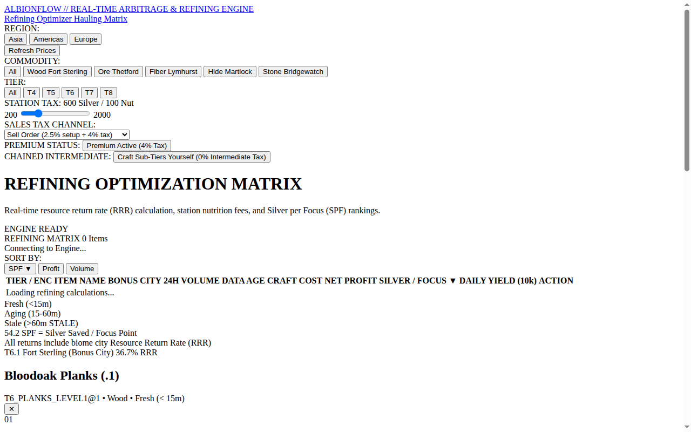
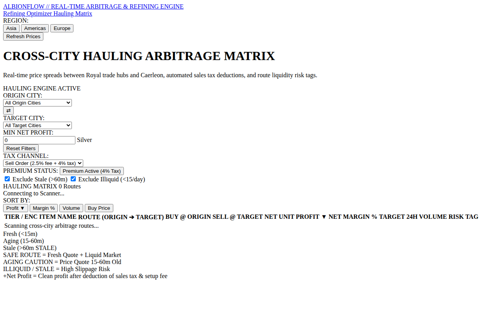

# ⚔️ Albion Arbitrage — Cross-City Market Arbitrage Scanner

> **Real-time Albion Online cross-city trading and transport arbitrage engine built with Go, Astro 5, and SQLite.**

---

## 📸 Visual Showcase & Market Telemetry

  

<em>Figure 1: Royal Continent Cross-City Market Arbitrage Dashboard (Bridgewatch, Fort Sterling, Lymhurst, Martlock, Thetford, Caerleon).</em>

 

  <table width="100%">
    <tr>
      <td width="50%" align="center">
        
         <strong>Figure 2: Real-time Price Tickers</strong> 
        <em>Live AODP market order ingestion and cross-city price spread calculations.</em>
      </td>
      <td width="50%" align="center">
        
         <strong>Figure 3: Profit Margin & Risk Scanner</strong> 
        <em>Net profit margin ranking after deducting market taxes, setup fees, and transport weight capacities.</em>
      </td>
    </tr>
  </table>

---

## 🏗️ Architecture

- **Go Backend Service:** High-concurrency market parser pulling live orders from the Albion Online Data Project (AODP).
- **Astro 5 Frontend:** Zero-JS baseline with island architecture for ultra-responsive search and sorting.
- **SQLite In-Memory Cache:** Fast spatial queries for trade route optimization.
